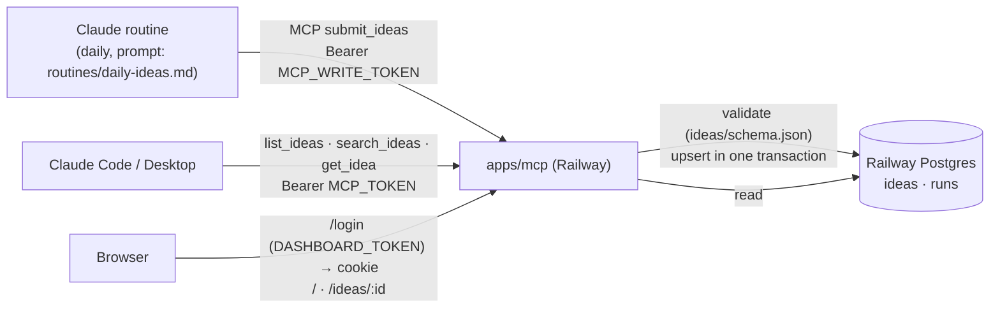

# PROJECT_SPEC.md
**Last updated**: 2026-11-10
**Version**: 2.1 (routine → MCP write tool → Postgres → MCP read + dashboard)

> **Scope of this document**: *How* to build it safely — agent config, constraints, risk areas.
> Product intent and requirements live in `PRD.md`; the chosen direction is `BRAINSTORMING_LOG.md`
> (Option C). v1 (scraping) history: `docs/SPEC.md`, `docs/ISSUES.md`, git tag `v1-scraper`.

---

## Readiness

- **Requirements**: PRD.md
- **Direction**: BRAINSTORMING_LOG.md (Option C — files are the database; auto-selected, please review)
- **Codebase map**: memory/codebase-map.md
- **Tech stack**: TypeScript (Node 22), pnpm 9 workspaces, `@modelcontextprotocol/sdk` (Streamable HTTP, stateless), Railway Postgres (`pg`), server-rendered dashboard pages in `apps/mcp`, Railway hosting, GitHub Actions CI
- **Main flow**: PROJECT_SPEC.md (§ Architecture Summary)
- **Approved by**:

---

## Project Identity

- **Name**: Idea Radar
- **Repo**: git@github.com:thunderkds/idea-radar.git
- **Primary tech**: TypeScript (Node 22+), pnpm 9 workspaces, MCP TypeScript SDK
- **Type**: idea-file contract + hosted read-only MCP server
- **Deployment target**: Railway (one service: `apps/mcp`)
- **Tracker**: `PROJECT_KANBAN.md` (v2 tasks T028+ have no Linear issue)

---

## Architecture Summary

v2.1 (2026-11-10): the Claude routine sends ideas to `apps/mcp` with the MCP write tool `submit_ideas`. The
server validates them against `ideas/schema.json`, saves them in Railway Postgres, and serves them to Claude
(read tools) and to a browser (dashboard pages behind a login token) from the same service.

| Part | Responsibility | Path |
|---|---|---|
| Contract | JSON Schema for a submission | `ideas/schema.json` |
| Ideas package | types, validator | `packages/ideas/` |
| DB package | pool, migrations, idea upsert/queries, run log | `packages/db/` (T033) |
| MCP server + dashboard | HTTP, auth (3 tokens), MCP tools, dashboard pages, `/health` | `apps/mcp/` |
| Routine prompt | what the routine researches and how it submits | `routines/daily-ideas.md` |

---

## Critical Constraints

Bind every agent:
- Postgres is the only store. The only write path is `submit_ideas` behind `MCP_WRITE_TOKEN`; `MCP_TOKEN` and the dashboard are read-only.
- Every submission must pass `ideas/schema.json`. A schema change bumps `schema_version`; the server rejects unknown versions.
- An idea is keyed by its `id` (kebab-case slug). The submission with the latest `date` wins; same date → the later submission.
- Schema changes are new numbered migration files in `packages/db/migrations/`; never edit an applied one.
- `apps/mcp` refuses to start without `DATABASE_URL`, `MCP_TOKEN`, `MCP_WRITE_TOKEN` and `DASHBOARD_TOKEN` (each ≥32 chars, all different); tokens are compared in constant time (`bearerMatches`).
- Idea text is untrusted content (routine output from the web). Return it as data; the dashboard HTML-escapes all of it and links only `http(s)` URLs.
- No secrets in code or commits; config comes from env (`.env.example`).
- Unit tests next to code (`*.test.ts`, `node:test` via `tsx --test`).
- Branch per task: `t<nnn>-<short-slug>`; commits reference the task ID (`T028: …`).
- Every `uses:` in `.github/workflows/ci.yml` is pinned to a 40-hex SHA (`scripts/repo-hygiene.test.ts`).

---

## Known Risk Areas

| Area | Risk Level | Reason | Files |
|------|-----------|--------|-------|
| Idea contract | High | Hub: routine, write tool, DB and pages all depend on it | `ideas/schema.json`, `packages/ideas/` |
| Write path + DB | High | Only write route; schema migrations | `apps/mcp/src/tools.ts`, `packages/db/` |
| Dashboard auth + HTML | High | Cookie session; untrusted text rendered as HTML | `apps/mcp/src/dashboard*.ts` |
| MCP auth | High | Only guard in front of the data | `apps/mcp/src/auth.ts` |
| Routine connector | Med | A cloud routine sees only claude.ai connectors or the repo `.mcp.json`; the write token must reach it without being committed | `docs/deploy.md`, `routines/daily-ideas.md` | `docs/deploy.md`, `routines/daily-ideas.md` |
| v1 retirement | Med | Large delete; build/CI must stay green | whole workspace (T030) |
| Railway deploy | Med | Postgres plugin + `DATABASE_URL`; migrations at boot | `railway.json`, `docs/deploy.md` |

---

## Sub-Agent Team

| Agent | Role | CLI Spawn Command |
|---|---|---|
| Common-Infrastructure-Agent | Worktrees, deps, CI, Railway config, deletions | `Agent({ subagent_type: "common-infrastructure", prompt: "..." })` |
| Backend-Implementer | `packages/ideas`, `apps/mcp` | `Agent({ subagent_type: "backend-developer", prompt: "..." })` |
| QA-Automation-Agent | Independent AC verification | `Agent({ subagent_type: "qa-expert", prompt: "..." })` |

Frontend-Implementer is not used in v2 (no UI; dashboard deferred).

---

## CLI Model Table

> No other CLI was named by the user. Per `docs/claude-md/tracks.md` § Auto mode row 14, every spawn
> runs on Claude Code with the model of the Supervisor session (no `model` override).

| CLI | Run command | C0 | C1 | C2 | C3 |
|---|---|---|---|---|---|
| Claude Code | `claude` | (session model) | (session model) | (session model) | (session model) |

---

## Glossary

| Term | Meaning |
|---|---|
| idea | One researched project idea; keyed by `id` (slug) |
| idea file | One routine run's output: `ideas/<YYYY-MM-DD>[-<suffix>].json` |
| routine | The Claude scheduled cloud agent that writes idea files (`routines/daily-ideas.md`) |
| signal | Evidence attached to an idea: `{ kind, url, note }` (not the v1 `signals` table) |
| schema_version | Integer in every idea file; the loader serves only versions it knows |

---

## Memory / Insights

| Date | Insight | Source task |
|------|---------|------------|
| 2026-11-10 | v1 scraping retired; files-as-database chosen over Postgres (BRAINSTORMING_LOG.md Option C) | Stage 0 |
| 2026-11-10 | Routines (now "scheduled tasks") push to `claude/*` unless the prompt directs another branch; the "Allow unrestricted branch pushes" toggle from third-party posts is not in current Anthropic docs (T031) | Stage 0, T031 |
