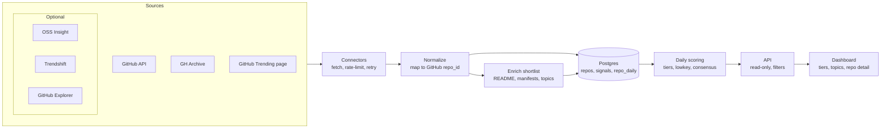

# Idea Radar — v1 Spec

Source of truth: [Idea Radar — v1 Spec](https://claude.ai/artifact/3tr3iGY9jjLTiCm21Ejyta) (this file is a snapshot as of 2026-10-31). Work is tracked in the [Linear project](https://linear.app/thunderkds/project/idea-radar-v1-8d2ecdbf26cf); see [ISSUES.md](ISSUES.md) for the task list.

## Overview

Idea Radar finds public GitHub repos in three tiers — trending, medium and lowkey — and shows what ideas and stacks are rising. v1 is GitHub-only, with GitHub as the primary source and GitHub-derived services (OSS Insight, Trendshift, Star History, GitHub Explorer) as optional signal providers.

**The gap it fills.** Existing tools cover the top of the curve: GitHub Trending, OSS Insight, Star History, Trendshift. None reliably surfaces good repos with under ~200 stars. The lowkey tier is the differentiator.

**v1 delivers**

- Daily ingestion from GitHub, GH Archive and optional third-party sources, normalized to the GitHub repo ID.
- Three tiers with transparent, tunable scoring.
- Cross-source consensus: which sources flag a repo, and who caught it first.
- A dashboard with tier tabs, filters, per-repo detail and rising topics.

**Roadmap**

| Version | Scope |
| --- | --- |
| v1 | GitHub + GitHub-derived sources, three tiers, dashboard |
| v2 | Chatbot over the stored data: explore ideas, match contributors to good-first-issues |
| v3 | Open sources: GitLab, Medium and others via new connectors |

## Sources

GitHub API is the single source of truth for repo metadata; every other source contributes signals keyed by GitHub repo ID.

| Source | Ingest | Limits / cost | Role | Required |
| --- | --- | --- | --- | --- |
| [GitHub API](https://docs.github.com/en/graphql/overview/rate-limits-and-query-limits-for-the-graphql-api) | REST + GraphQL | 5,000 GraphQL points/hr per token; 2,000 points/min; Search 30 req/min; max 100 concurrent (REST + GraphQL) | Metadata, README, manifests, issues | Yes |
| [GH Archive](https://www.gharchive.org) | Hourly dumps or BigQuery | Free dumps; BigQuery query cost | Star/fork/push velocity for all public repos — basis of the lowkey tier | Yes |
| GitHub Trending page | Daily HTML scrape | ~25 repos per language/period; brittle | "Officially trending" flag | Yes |
| [OSS Insight](https://ossinsight.io/docs/api) | Public REST API, `api.ossinsight.io/v1` | No key; 600 req/hr per IP | Trending by period/language; curated collections as category tags | Optional |
| [Trendshift](https://trendshift.io/signal) | Signal API | $9/month Starter; **no redistribution of raw data** | Engagement-spike signal; historical GitHub Trending snapshots | Optional, internal scoring only |
| Star History | Embed charts/badges | Free embeds; no bulk API | Presentation only; own star history comes from GH Archive | Optional |
| GitHub Explorer | Read committed `data/projects.json` from its repo | Free; check repo license | AI/agent curation signal | Optional |

**Licensing rule:** a source whose terms forbid redistribution (Trendshift) may feed scores but is never shown raw or re-exposed via our API. In code this is `displayable: false` on the connector.

## Architecture

Every source is a connector behind one interface; connectors write signals, a daily job turns signals into tiers, and the dashboard reads scores through an API.



Normalize and Enrich both write to Postgres. Star History is not in the pipeline — only embedded on repo pages. The scheduler runs GH Archive hourly and the other connectors daily.

**SourceConnector interface** (`packages/core/src/connector.ts`) — a v3 source (GitLab, Medium) is a new implementation, not a rewrite:

```ts
interface SourceConnector<RawItem> {
  id: string;              // 'github_trending', 'ossinsight', ...
  name: string;
  enabled: boolean;
  licenseNote: string;     // e.g. 'no redistribution'
  displayable: boolean;    // false → scoring only, never shown or exposed
  rateLimit: { perHour: number; concurrency: number };
  schedule: 'hourly' | 'daily';
  fetch(since: Date): AsyncIterable<RawItem>;
  normalize(item: RawItem): Signal[];   // keyed by GitHub repo_id
}
```

Stack: TypeScript (Node 22), Postgres 16, pnpm workspaces, Next.js dashboard. The scheduler starts as a simple interval loop and moves to a queue-backed runner in HUN-144.

## Data model

One canonical repo table plus an append-only signal table; every source writes signals, only the GitHub API connector writes repo metadata. Schema: `packages/db/migrations/001_init.sql`.

| Table | Key columns | Notes |
| --- | --- | --- |
| repos | repo_id (GitHub numeric ID), full_name, description, language, topics[], license, created_at, pushed_at, stars, forks, archived | Canonical; full_name can change on rename, repo_id never does |
| repo_daily | repo_id, date, stars_new, forks_new, pushes, issues_opened, prs_opened, distinct_actors | Rolled up from GH Archive; drives velocity |
| signals | repo_id, source, signal_type, value (jsonb), observed_at | Append-only; e.g. ossinsight/trending, github_trending/listed, trendshift/engagement_spike |
| repo_content | repo_id, readme_md, manifests (jsonb), file_tree_summary, stack_tags, fetched_at | Shortlist only; feeds tags now and v2 embeddings later |
| repo_scores | repo_id, date, tier, score, components (jsonb), consensus_count, fake_star_flag | Recomputed daily; components keep the score explainable |
| sources | id, name, enabled, displayable, license_note, last_run_at, last_status, last_error | Connector registry + health |

Forward-compatible for v3: add `source_host` (github, gitlab) and `entity_type` (repo, article) on repos when new sources land; no other table changes.

## Tier scoring

Tiers are set by momentum and health, not raw star counts. Every threshold and weight is a starting point to tune against a hand-labelled sample; they live in `packages/core/src/scoring.ts`.

| Tier | Entry rule (starting point) | Ranked by |
| --- | --- | --- |
| Trending | Top 1% of 7-day star velocity, or listed on GitHub Trending / OSS Insight this week | 7-day stars, consensus count |
| Medium | 500+ stars and positive 30-day velocity for 4+ consecutive weeks, not in Trending | 30-day growth rate, activity |
| Lowkey | Under ~200 stars, pushed in last 30 days, 2+ distinct contributors, README present, 7-day velocity above its own 90-day baseline | Lowkey score |

Tiers are evaluated in order: trending, then medium, then lowkey. A repo matching none gets no tier.

**Lowkey score** — weighted sum of components normalized to 0..1, stored per repo in `repo_scores.components` so the dashboard can explain it:

```
score = 0.35 · velocity_lift + 0.25 · activity + 0.15 · contributors
      + 0.15 · readme_quality + 0.10 · issue_responsiveness
```

**Fake-star filter** — discount stars from accounts under 30 days old or with no public activity, and flag bursts (e.g. 50+ stars within an hour from low-activity accounts). Flagged repos are shown with a warning, not hidden.

**Source consensus** — `consensus_count` = number of distinct sources flagging the repo in the last 7 days, with the first-seen date per source. It boosts Trending ranking and powers the "who caught it first" timeline.

## Dashboard views

Five views ship in v1; the lowkey tab is the default landing view.

| View | What it shows |
| --- | --- |
| Tier tabs | Trending / Medium / Lowkey lists; filters for language, topic, OSS Insight collection, date window |
| Repo detail | Star history (own data; Star History embed optional), score breakdown, source-consensus timeline, README excerpt, detected stack |
| Rising topics | Topics and dependencies with the fastest growth in new repos over 7/30 days |
| Source consensus | Repos flagged by 2+ sources, with who flagged them first |
| Ops | Connector health, last run, rate-limit usage, ingest lag |

## Milestones

v1 runs in four milestones, each shippable on its own; no dates set yet.

1. **M1 Foundation** — repo scaffold, Postgres schema, SourceConnector interface, scheduler, GitHub API connector.
2. **M2 Core ingestion** — GH Archive daily rollup, GitHub Trending scraper, README/manifest enrichment for the shortlist.
3. **M3 Scoring** — three tiers, lowkey score, fake-star filter, optional connectors (OSS Insight, Trendshift, GitHub Explorer), source consensus.
4. **M4 Dashboard** — the five views above, deployed.

## Risks

- GitHub Trending HTML changes break the scraper → keep it isolated; Trendshift's historical snapshots are a fallback.
- GH Archive volume (millions of events/day) → filter to Watch/Fork/Push/Issues/PR events at ingest; consider ClickHouse if Postgres rollups slow down.
- Lowkey tier fills with noise (tutorials, homework repos) → hand-label ~200 repos to tune thresholds.
- Third-party terms change → license note per connector; each is behind an enabled flag.

## Open questions

- [ ] Primary user: indie builder, contributor, or scout?
- [x] Product name: Idea Radar
- [ ] Hosting and budget: BigQuery vs downloading GH Archive dumps
- [ ] Public dashboard or private first?
