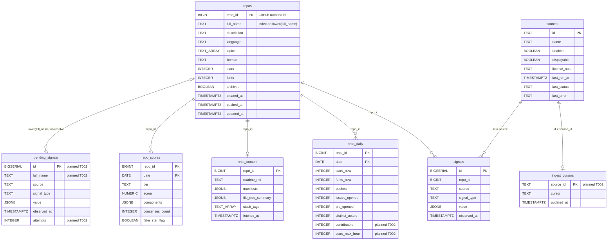
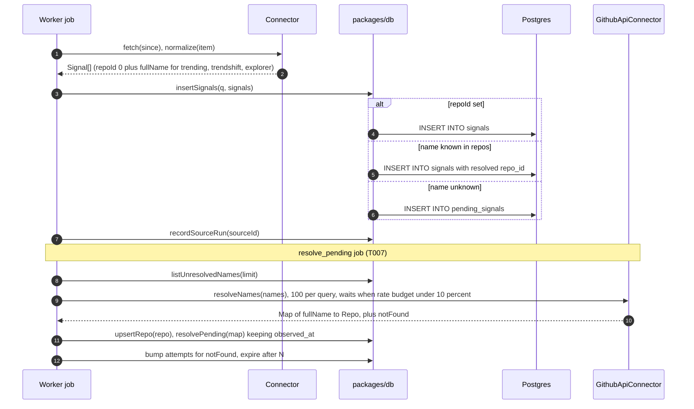
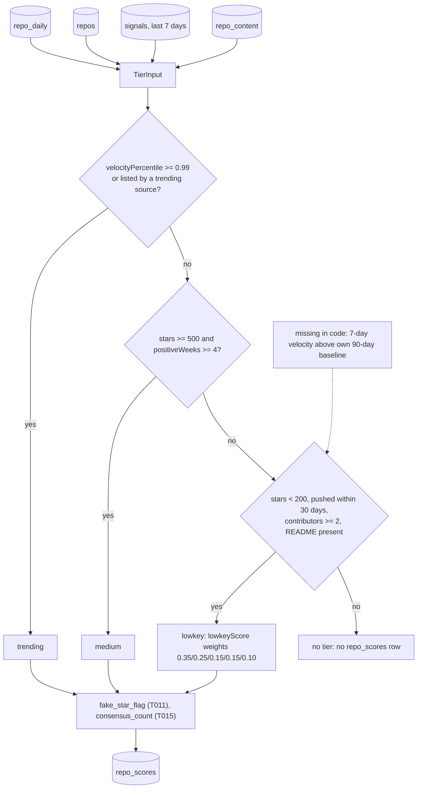

# Gap analysis — docs, architecture, diagrams (2026-10-31)

Three read-only reviews of branch `setup/supervisor-kit` (HEAD `92fe8a4`) against `docs/SPEC.md` and `docs/ISSUES.md`. This file is the record; fixes are tracked as board tasks (see "Where each gap goes").

## Decisions for the product owner

None of these blocks wave 1 (T002–T005); each blocks the task named.

| # | Question | Blocks | Default used until decided |
|---|---|---|---|
| U1 | Medium tier: what does "positive 30-day velocity for 4+ consecutive weeks" mean? (any star in 30 days is almost always true for 500+ star repos) | T009 | — |
| U2 | GH Archive backfill depth (90-day lowkey baseline needs ~2,160 hourly dumps) and dumps vs BigQuery | T004 config, T009, T017 | dumps; `GHARCHIVE_BACKFILL_DAYS=1` |
| U3 | GitHub API point budget for fake-star stargazer sampling | T011 | — |
| U4 | May the displayed consensus count include Trendshift, or only displayable sources? | T015, T016 | displayable sources only in API output |
| U5 | How long all-repo `repo_daily` is kept vs full star history for charts | T009, T017, T019 | keep all |
| U6 | Does GH Archive / Idea Radar itself appear on the "who caught it first" timeline? | T015 | no |
| U7 | Is v3 multi-host (GitLab ids collide with GitHub ids) a constraint on the v1 schema? | v3 | no; SPEC claim to be corrected |
| U8 | "Contributors" for the lowkey rule = distinct pushers + PR openers? | T004, T009 | yes (see A4) |

## Architecture gaps (engineering), most severe first

| # | Gap | Resolution | Owner |
|---|---|---|---|
| A1 | Nothing selects lowkey candidates: GH Archive writes only `repo_daily`, only the GitHub API connector writes `repos`, and the shortlist needs signals GH Archive never emits | New "candidate selection" step over `repo_daily` + `signals`, persisted (`candidates(date, repo_id, reason)`), feeding metadata fetch and enrichment | new task T021 |
| A2 | `classifyTier` lacks the lowkey "7-day velocity above own 90-day baseline" rule; trending/medium `score` formula undefined | Add `velocity7d`, `baseline90dDaily` to `TierInput`; define per-tier score | T009/T010 (+U1) |
| A3 | Baselines need ~90 days of history; repos with less must be marked, not scored 0 | `insufficient_history` component flag | T009/T010 (+U2) |
| A4 | `distinct_actors` includes stargazers; not "contributors"; daily distinct counts cannot be summed | `repo_daily.contributors` (distinct actors of Push + PR-opened) | **T002 migration, T004** |
| A5 | Fake-star burst rule needs hourly star counts; day rollup drops the hour | `repo_daily.stars_max_hour` | **T002 migration, T004** |
| A6 | One GitHub token shared by metadata, resolution, enrichment, fake-star, Explorer; per-process rate tracking will overspend | Single shared GitHub client/budget lane | T007 |
| A7 | `github_api/metadata` signals inflate `consensus_count` and duplicate `repos` | `GithubApiConnector.normalize` returns `[]`; metadata goes to `repos` via `toRepo` | **T003** |
| A8 | `pending_signals` has no drain owner, no expiry; resolution must keep original `observed_at` | `attempts`, `last_attempt_at`, expiry after N; `resolvePending` keeps `observed_at`; T007 owns the `resolve_pending` job | **T002**, T007 |
| A9 | Scheduler job order undefined; GitHub API work does not fit `fetch(since)` | T007 guide: `gh_archive(D)` → candidates → resolve + metadata → enrich → `score(D)`, keyed by data date | **T003** (no mutable candidate state), T007 |
| A10 | `displayable=false` has no single enforcement point; `sources.displayable` defaults TRUE; leaks via `components`, consensus, timelines | One API serializer strips non-displayable sources; source of truth = code registry | T006, T013, T016 |
| A11 | Shortlist ordering/cap/storage undefined | Shortlist = A1 candidates ordered by velocity lift, then consensus | T008, T021 |
| A12 | Append-only `signals` duplicate on job retry | `run_id` or unique key + `ON CONFLICT DO NOTHING` | T007 |
| A13 | `repo_daily` ~0.4–1B rows/year; no retention/partitioning | Monthly partitions or candidate-only history | T019 (+U5) |
| A14 | `repo_scores` has no completed-run marker | `score_runs(date, status, finished_at)`; API reads latest completed date | T009 |
| A15 | First-seen per source is fragile if derived from `signals` | `repo_source_first_seen(repo_id, source, first_seen_at)` upserted with `LEAST()` | T015 |
| A16 | Core types vs SQL: `RepoScore` lacks `fakeStarFlag`; `Repo.createdAt` non-null vs nullable column; `pg` returns BIGINT/NUMERIC as strings | Fix types; set `pg` type parsers | **T002** |
| A17 | SPEC v3 forward-compat claim is false (repo_id is GitHub-only) | Correct SPEC | T020 (+U7) |
| A18 | `issueResponsiveness`, rising topics and collection filter have no data source | GraphQL for shortlist; candidate universe; `repo_tags` | T010, T012, T018 |
| A19 | Smaller: `migrate.ts` has no advisory lock; `ossinsight.ts` `Number(repo_id)` may be NaN; env vs DB `enabled` precedence undefined | Advisory lock (**T002**); validate (T012); code wins (T006) | various |

## Documentation gaps, most important first

| # | Gap | Fix |
|---|---|---|
| D1 | `.env` is never loaded (no dotenv, no `--env-file`); README says `cp .env.example .env` | Load it (`tsx --env-file`) or document `set -a; . ./.env` |
| D2 | No env var reference (`NEXT_PUBLIC_API_URL` missing from example; defaults and token scopes undocumented) | `docs/configuration.md` |
| D3 | No integration-test / local Postgres guide; `TEST_DATABASE_URL` shares the dev DB; port clash 5432 | `docs/testing.md` (T002 uses a temp schema) |
| D4 | README Node version and dev-script claims wrong after T001; no `.nvmrc` | README fix, `.nvmrc` |
| D5 | `pnpm lint` does nothing; README skips typecheck/test | README + AGENTS § Commands |
| D6 | No API contract (shapes, filters, cursor, errors, CORS, displayable rule) | `docs/api.md` before T016 |
| D7 | No connector authoring guide (`repoId: 0` convention, ids, signal types, rate limits, fixtures) | `docs/connectors.md` |
| D8 | Data model doc vs SQL drift; required storage (cursor, queue, first-seen, jobs, rate usage) absent | `docs/SPEC.md` § Data model with migration 002 |
| D9 | Scoring docs vs code mismatch; `components` schema undefined | `docs/scoring.md` |
| D10 | Open questions and implicit choices have no decision records | `docs/adr/` |
| D11 | Source licensing terms only in code strings | `docs/sources-licensing.md` |
| D12 | No runbook, no deployment doc | `docs/runbook.md`, `docs/deploy.md` (T019) |
| D13 | CI narrower than the done-rule (no `pnpm test`, no `--frozen-lockfile`) | CI step |
| D14 | No CONTRIBUTING, per-package READMEs, LICENSE; branch convention vs kit branches | `CONTRIBUTING.md`, package READMEs |
| D15 | HUN-150 `scripts/label.ts` collides with the kit's `scripts/` folder | use `tools/` |

## Diagram gaps

The one diagram (`docs/SPEC.md` § Architecture) shows the target shape but misdraws it: GH Archive is drawn as a signal source (it writes only `repo_daily`); name resolution and the `pending_signals` loop back to the GitHub API are missing; Enrich reads from Postgres, not inline after Normalize; Scoring writes `repo_scores` and the API reads Postgres; no Scheduler; no `displayable=false` boundary; Star History embed-only is not marked.

Missing diagrams, ranked: 1 data-model ER; 2 signal write path + name resolution (sequence); 3 tier classification pipeline (flowchart); 4 GH Archive day loop; 5 scheduler job graph; 6 licensing boundary; 7 pending-signal lifecycle; 8 shortlist enrichment. Drafts for 1–3 below are unrendered; check them in a mermaid renderer before they go into `docs/SPEC.md` (T020).

### Draft 1 — data model

### Draft 2 — signal write path and name resolution

### Draft 3 — tier classification

## Where each gap goes

- Wave 1 guides updated now: A4, A5, A8, A16, A19 (advisory lock) → T002; A7, A9 → T003; A4, A5 → T004.
- New board tasks: **T020** docs + diagrams (D1–D15, A17, the drafts above); **T021** candidate selection (A1, A11).
- Later guides carry the rest (written before pickup).
